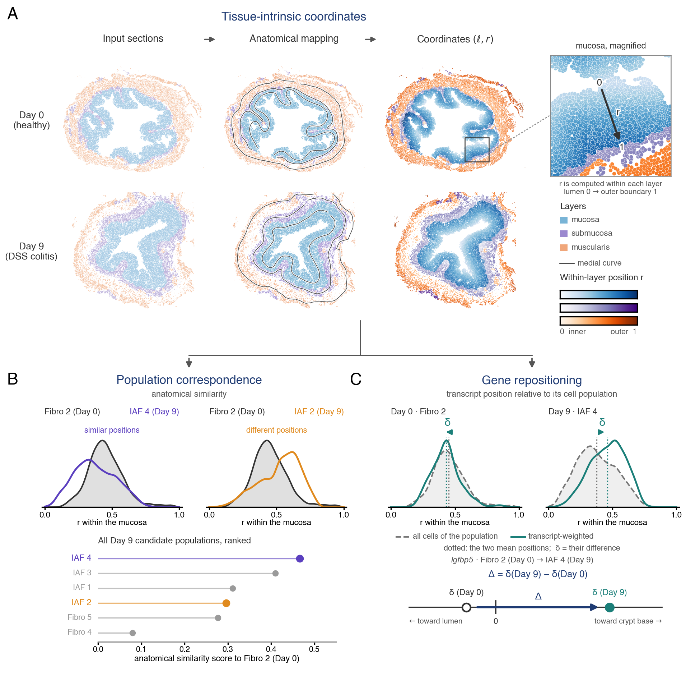

# Tissue-Intrinsic Coordinates for cell and gene Repositioning



Compares spatial transcriptomics sections across tissue states without registering
them. Every cell is represented by its anatomical layer and a normalized within-layer position
`r ∈ [0, 1]` (tissue-intrinsic coordinates), and two analyses run on these coordinates:

- **Cell-population correspondence.** Positional distributions of candidate populations are
  compared within layers by Jensen–Shannon distance and combined across layers to rank which
  population in one condition occupies the anatomical niche of a population in another.
- **Population-relative gene displacement.** For a gene within a population, the statistic
  δ measures the transcript-weighted position relative to the host population itself. Sections
  are pooled per condition by random-effects meta-analysis (REML + Knapp–Hartung) and the
  contrast Δ = δ<sub>disease</sub> − δ<sub>control</sub> is tested with a Welch t test. This
  separates genuine repositioning of a gene inside a population from movement or abundance
  changes of the population.

The package accompanies

> Shuying Han and Rong Ma. *Quantifying Cell and Gene Repositioning Across Tissue States Using
> Tissue-Intrinsic Geometric Coordinates.* Submitted to RECOMB 2027.

The analyses of the paper (colon DSS-colitis and MC903 skin MERFISH atlases, benchmark against
moscot, PASTE2, SLAT and STalign, simulations, figures) are in [`reproducibility/`](reproducibility/README.md).

## Reproduce the paper (start here)

Three levels, documented in [`reproducibility/README.md`](reproducibility/README.md):

1. **Method demonstration** (minutes, no download): install the package and run
   `vignette("quick_start", package = "TICR")` and the unit tests. Both analyses run on example data
   shipped with the package (one colon section pair; the *Igfbp5* displacement of Figure 5D).
2. **Manuscript figures** (≈ 15 min): download the checkpoint release (93 curated coordinate files
   and the small result tables of every stage; download location to be added when published), unpack
   it into `reproducibility/`, and run the figure scripts. Every submitted PNG regenerates
   byte-identically; see [`FIGURE_REPRODUCTION_MANIFEST.md`](FIGURE_REPRODUCTION_MANIFEST.md).
3. **Full analysis from the public atlas** (days; cluster): section export → coordinate fitting →
   correspondence and benchmark → gene displacement → simulation, with each step marked as automatic,
   cluster-scale, or requiring intervention. One step cannot be automated: 74 of the 93 coordinate
   fits were hand-traced in MorphoGAM, which is why the coordinates are distributed as a checkpoint.

| Figure | Script (`reproducibility/manuscript_figures/`) | Inputs (all in the checkpoint release) |
|---|---|---|
| Fig. 1 framework | `make_fig1_v11.py` | coordinates; `fig1_assets/` |
| Fig. 2 correspondence | `make_fig2_correspondence.py` | coordinates; our per-pair matrices |
| Fig. 3 benchmark | `make_fig3_benchmark_v2.py` | `fig23_assets/per_pair_norm_rank_v2.csv`; Day 9 composition tables |
| Fig. 4 simulation | `make_fig4_simulation.R` | simulation result tables |
| Fig. 5 gene repositioning | `make_fig5_repositioning_v2.py` | `fig23_assets/` (gene calls, cells); `fig1_assets/` |
| Supplement: FDR and ablation | `make_fig3_gene_simulation.R` | simulation result tables |
| Supplement: benchmark sensitivity | `make_figS_benchmark_sensitivity.py` | `per_pair_scores_all_methods.csv`, `atlas_sections.csv`, coordinates |
| Supplement: skin application | `make_figS_skin_validation.R` | values from the skin report (runs as is) |

The benchmark comparators are moscot, PASTE2, SLAT and STalign. Their per-pair outputs were computed
on a SLURM cluster; the scored tables are in the checkpoint release, and the harness to recompute
them is in `reproducibility/script/`.

## Installation

```r
# install.packages("remotes")
remotes::install_github("ShuyingHan410/tissue-intrinsic-repositioning", build_vignettes = TRUE)
# coordinate fitting additionally needs MorphoGAM (Nicol et al. 2024):
remotes::install_github("phillipnicol/MorphoGAM")
```

The correspondence and displacement analyses depend only on `metafor`; the coordinate fitter
uses `MorphoGAM`, `FNN`, `Matrix`, `igraph`, `RSpectra` and `mgcv`.

## Quick start

### Tissue-intrinsic coordinates

Input: one section as a per-cell table with `x`, `y`, a layer label and a population label (the
atlas section tables are not shipped; `reproducibility/README.md` §2 says how to export them).

```r
library(TICR)
cells <- read.csv("my_section.csv")   # your own section: columns x, y, a layer label, a population label
mu    <- fit_layer_coordinates(cells, "MU", layer_col = "Leiden_neigh")   # mucosa; needs MorphoGAM
mu$r_for_jsd <- orient_outward(mu$r_for_jsd, mu$x, mu$y)$r          # 0 = lumen, 1 = outer
```

### Cell-population correspondence

```r
f <- system.file("extdata", "colon_fibroblast_two_sections.csv", package = "TICR")
cells <- read.csv(f)                        # section, condition, layer, population, cell_id, r
S <- population_similarity(cells, groups = c("Day0", "Day9"))
rank_candidates(S, "Fibro 2", target = "IAF 4")   # Day 9 candidates for healthy Fibro 2
pool_similarity(list(S))                          # average over section pairs: list(S_pair1, S_pair2, ...)
```

### Population-relative gene displacement

```r
f <- system.file("extdata", "igfbp5_fibro2_iaf4.csv", package = "TICR")
d <- read.csv(f)                            # Fibro 2 (Day 0) and IAF 4 (Day 9) cells, Igfbp5 counts
sec <- delta_by_section(d, "Igfbp5", keep = c("condition", "mouse"))   # one row per section
res <- test_displacement(sec, levels = c("Day0", "Day9"))
res$contrast     # Delta, CI, Welch df, p
res$pattern      # "reversed": luminal at Day 0, crypt-base at Day 9
```

`section_delta(r, n)` exposes the statistic for one section, `pool_sections()` and
`contrast_conditions()` the two inference steps. For a genome-wide run, apply
`delta_by_section()` per gene and adjust the p-values with Benjamini–Hochberg within each
correspondence × anatomical-layer family (eight families in the colitis analysis;
`reproducibility/gene_spatial_cluster/04_figure5_calls.R`). The vignette walks through all three steps:
`vignette("quick_start", package = "TICR")`.

## Repository layout

```
R/                 package source (coordinates.R, correspondence.R, displacement.R)
inst/extdata/      example data used in the vignette and tests
vignettes/         quick_start.Rmd
tests/             unit tests (testthat)
reproducibility/   every analysis in the paper (code only): coordinate construction for both
                   atlases, correspondence benchmark, gene-level pipeline, simulations, figure
                   scripts; inputs come from the public Dryad and Mendeley datasets
```

## Citation

```
Han S, Ma R. Quantifying Cell and Gene Repositioning Across Tissue States Using
Tissue-Intrinsic Geometric Coordinates. Submitted to RECOMB 2027.
```

MorphoGAM: Nicol PB, Ma R, Xu RJ, Moffitt JR, Irizarry RA. Identifying spatially variable
genes by projecting to morphologically relevant curves. bioRxiv 2024, doi:10.1101/2024.11.21.624653.

License: MIT (`LICENSE.md`).
